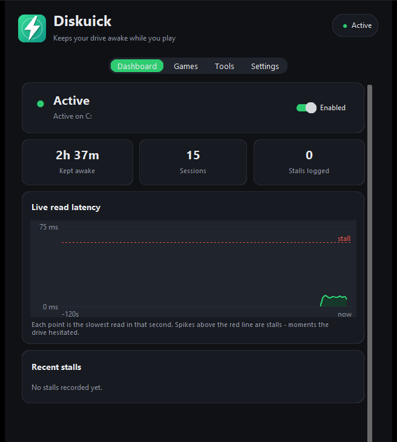
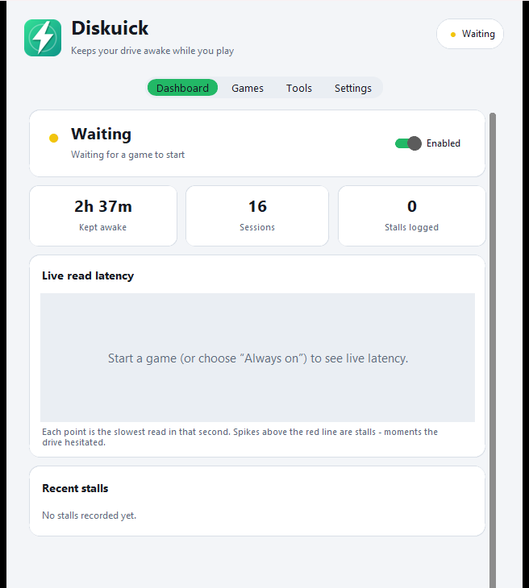
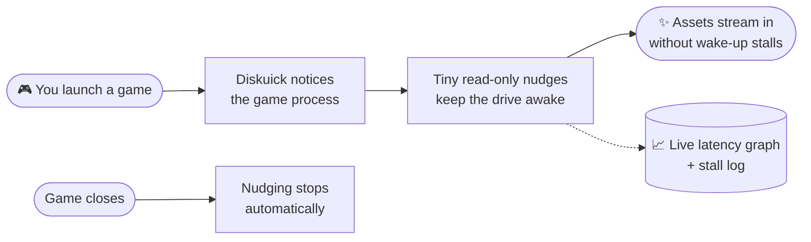
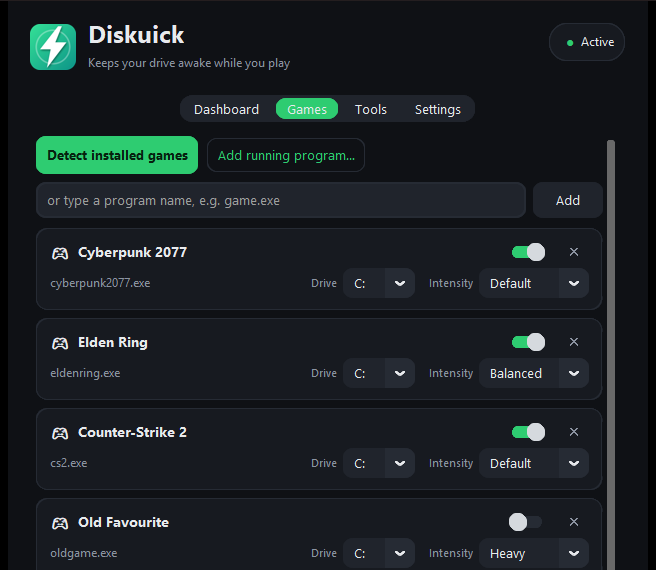
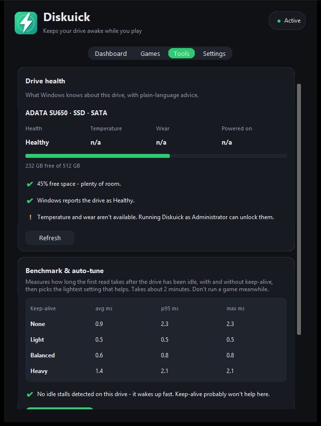
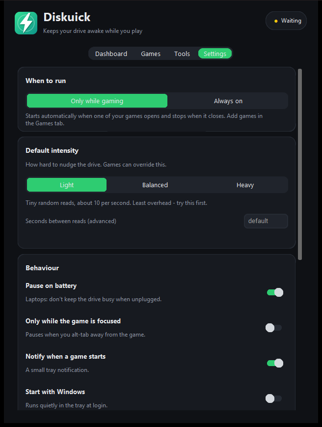

<div align="center">


# Diskuick

### Keep your game drive awake, so your games stop stuttering.

A tiny Windows tray app that gives your SSD a gentle, read-only nudge while you play,<br>
so it never falls asleep right when a game needs data.

<br>

[](#)
[](#)
[](https://github.com/GlensonAnsin/diskuick/releases/latest)
[](#-faq)
[](LICENSE)

<br>

[](https://github.com/GlensonAnsin/diskuick/releases/latest)

<br>

&nbsp;&nbsp;

<sub>Dashboard in dark and light themes (sample data).</sub>

</div>

<br>

## 🎯 Why Diskuick?

Some SSDs, especially budget **DRAM-less SATA** models, drop into a low-power idle state and are slow to
respond to the *first* reads after sitting idle. In a game that shows up as hitches while textures and
levels stream in. Many people notice that running a disk scanner (like HD Tune's error scan) in the
background makes the stutter vanish, because the drive is kept continuously busy.

**Diskuick does the same thing, but gently and only when needed:** a tiny, steady, read-only load on the
drive while your game is running, and nothing the rest of the time.

> [!IMPORTANT]
> **This is a workaround, not a cure, and it only helps if idle wake-up is your actual problem.**
> That's what the built-in **Benchmark & auto-tune** and **Lag check** are for: they measure *your* drive
> instead of asking you to take this on faith. If your drive is nearly full, failing or overheating, or the
> bottleneck is your CPU, RAM or GPU, Diskuick won't fix it, and the app will tell you when it spots those.

<br>

## ⚙️ How it works



Diskuick reads a small random-data **probe file** with unbuffered I/O (so reads really hit the disk, not
the cache). It never touches your game files, and it only looks at the *names* of running programs.

<br>

## ✨ Features

<table>
<tr>
<td width="50%" valign="top">

### 🚀 Keep-alive engine
- Three intensities: **Light**, **Balanced**, **Heavy**
- Starts and stops with your game, automatically
- **Multi-drive** support and **per-game profiles**
- Pause on battery, or only while the game is focused

</td>
<td width="50%" valign="top">

### 🔍 Proves it works
- **Benchmark & auto-tune** finds the lightest setting that actually helps *your* drive
- **Live latency graph** with a red stall line
- **Stall log** and session stats
- **Lag check**: 30 s of real disk, CPU and RAM sampling with plain-language findings

</td>
</tr>
<tr>
<td width="50%" valign="top">

### 🎮 Effortless setup
- **Auto-detects games** from Steam, Epic Games and GOG
- Or pick any running program with one click
- Drive health, free-space and temperature tips
- Tray notifications when a game starts

</td>
<td width="50%" valign="top">

### 🎨 Polished
- Modern dark / light / system theme
- English and Filipino
- Optional on-screen **latency overlay**
- One-click **updates**, checksum-verified
- Installer, portable build, start with Windows

</td>
</tr>
</table>

### Intensity guide

| | What it does | Use it when |
|---|---|---|
| **Light** (default) | Tiny random reads, ~10 per second | Almost always. Least overhead, try this first |
| **Balanced** | Light sequential reads, ~20 per second | Light isn't quite enough on your drive |
| **Heavy** | Continuous reads, like HD Tune | Last resort. Strongest, but the drive is always busy |

<br>

## 🖼️ Screenshots

<table>
<tr>
<td align="center" width="50%">
<br>
<sub><b>Games</b>: auto-detect, per-game drive and intensity</sub>
</td>
<td align="center" width="50%">
<br>
<sub><b>Tools</b>: drive health and auto-tune, measured live</sub>
</td>
</tr>
<tr>
<td align="center" width="50%">
<br>
<sub><b>Settings</b>: changes apply instantly, no Save button</sub>
</td>
<td align="center" width="50%" valign="middle">
<br>
<sub><b>Optional overlay</b>: a small live readout in a screen corner (off by default)</sub>
</td>
</tr>
</table>

<sub>Game names and usage stats in the screenshots are sample data. Drive health and the benchmark were measured live on the author's PC, whose SSD happens not to stall, so the auto-tune result there says "no idle stalls detected".</sub>

<br>

## 🚀 Quick start

1. **Download** the installer from [Releases](https://github.com/GlensonAnsin/diskuick/releases/latest) and run it (no admin rights needed), or grab the portable zip.
2. Diskuick opens on the **Games** tab. Click **Detect installed games** and tick yours, or use **Add running program…**.
3. *(Recommended)* Open **Tools → Run auto-tune** to find the best intensity for your drive.
4. Close the window. Diskuick keeps working quietly from the **system tray**.

> [!NOTE]
> The app isn't code-signed yet, so Windows SmartScreen may show a warning the first time. Click
> **More info → Run anyway**.

<br>

## ❓ FAQ

<details>
<summary><b>🛡️ Is it safe?</b></summary>

<br>

Yes. Diskuick **only reads**, and only from one small file it creates itself:
`<drive>:\.diskuick\probe.bin` (256 MB of random data, written once). Reads don't wear flash. It never
modifies, scans or reads your game files, and it never injects into or inspects game processes, so it
doesn't interact with anti-cheat. The optional overlay is a separate click-through window, not a hook, so
it appears over windowed and borderless games but not exclusive fullscreen.

</details>

<details>
<summary><b>🌐 Does it use the internet?</b></summary>

<br>

Only to check GitHub for a newer release (you can turn this off in Settings). Nothing about you or your PC
is sent. Updates install only when you click **Update now**, only from GitHub's own HTTPS hosts, and only
if the download matches the release's SHA-256 checksum.

</details>

<details>
<summary><b>🤔 Will it fix my game's lag?</b></summary>

<br>

Only if the cause is your drive waking from idle. Run **Tools → Run auto-tune**: if the *None* row shows
slow first reads and a keep-alive row shows fast ones, it will help. If not, try the **Lag check** while
playing: it tells you whether the disk, CPU or memory looks like the bottleneck (GPU and network aren't
measured).

</details>

<details>
<summary><b>📁 Where does it store data? How do I uninstall?</b></summary>

<br>

Settings, stats and the stall log live in `%APPDATA%\diskuick\`. Uninstall from **Windows Settings → Apps**
(or the Start menu); it also removes that folder. For the portable build, delete the exe and, if you want,
the `.diskuick` folder on each drive (or run `python diskuick.py clean D`).

</details>

<details>
<summary><b>🌡️ Why are temperature and wear "n/a"?</b></summary>

<br>

Windows only exposes them to Administrators on most PCs. Run Diskuick as administrator if you want them.

</details>

<br>

## 🧰 For developers

<details>
<summary><b>Command line</b></summary>

<br>

```powershell
python diskuick.py bench D                    # idle-latency test with and without keep-alive
python diskuick.py run D --process game.exe   # keep a drive awake while a program runs
python diskuick.py clean D                    # delete the probe file
```

</details>

<details>
<summary><b>Build from source</b></summary>

<br>

Requires Python 3.12+ on Windows.

```powershell
.\build.ps1             # runs the tests, then builds dist\Diskuick.exe + portable zip (+ installer)
.\build.ps1 -SkipTests
python -m unittest discover -s tests
python docs\make_screenshots.py   # regenerate the README screenshots
```

The installer needs [Inno Setup 6](https://jrsoftware.org/isinfo.php) (free). Optional code signing:
set `DISKUICK_SIGN_PFX` / `DISKUICK_SIGN_PASSWORD` before building (needs `signtool.exe`).

</details>

<details>
<summary><b>Project layout</b></summary>

<br>

| File | Purpose |
|---|---|
| `diskuick.py` | Engine: unbuffered reads, keep-alive thread, benchmark, CLI |
| `controller.py` | Decides which drives to keep awake (games, drives, battery, focus) |
| `games.py` | Steam / Epic / GOG game detection |
| `health.py`, `lagcheck.py` | Drive health and the "why am I lagging" analysis |
| `app_ui.py`, `widgets.py`, `overlay.py` | The window (CustomTkinter) and the optional overlay |
| `diskuick_tray.py` | Entry point: tray icon, config, autostart, updates |
| `updater.py` | Release check and checksum-verified one-click update |
| `logo.py`, `make_icon.py` | The one logo, used for exe, tray and window icons |
| `installer.iss`, `build.ps1` | Inno Setup script and the build pipeline |

</details>

<details>
<summary><b>Publishing a release</b></summary>

<br>

1. Bump `VERSION` in `version.py`, then run `.\build.ps1`.
2. Create a GitHub release tagged `v<version>` and attach **all** of
   `dist\Diskuick-Setup-<version>.exe`, `dist\Diskuick-Setup-<version>.exe.sha256` and
   `dist\Diskuick-portable-<version>.zip`:
   ```powershell
   gh release create v1.2.0 dist\Diskuick-Setup-1.2.0.exe dist\Diskuick-Setup-1.2.0.exe.sha256 dist\Diskuick-portable-1.2.0.zip --title "Diskuick 1.2.0"
   ```
3. Installed copies then offer **Update now**; the portable exe offers **Download**.

</details>

<br>

## 🧭 Known limitations

- **Not code-signed**, so SmartScreen may warn (a certificate costs money).
- **Game detection** picks the largest non-installer `.exe` in a game folder, which is a best guess; fix it in the Games tab if a game doesn't trigger.
- **Lag check** doesn't measure GPU or network. **Overlay** doesn't show over exclusive-fullscreen games.
- **Filipino** translation is best-effort and would benefit from a native speaker's review (`i18n_fil.py`).

<br>

## 📄 License

Released under the [MIT License](LICENSE). Copyright © 2026 GlensonAnsin.

<div align="center">

Made for gamers with slow-waking SSDs. 💚

</div>
